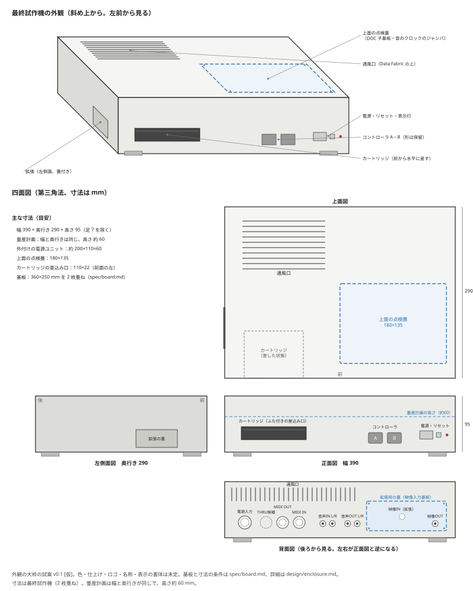

# 筐体（外観の大枠）

**v0.1**  
2026年11月25日

> 状態：作業中の版。外観の大枠だけを仮に決めた。意匠の規則（色・仕上げ・ロゴ・名称・表示の書体）は未定で、後で決める。寸法・端子・蓋の条件は [spec/board.md](../spec/board.md)（DR-036、DR-037）。決定記録は [DR-038](../decisions.md)。

記述ステータス：`[確定]`、`[仮]`、`[没]`。この文書の項目は、断りがなければすべて `[仮]`。

## 01　形と大きさ

| 項目 | 内容 | 正典 |
|---|---|---|
| 形 | 横置きの平たい箱。上面は平ら | [仮] |
| 大きさ（最終試作機） | 幅 390 × 奥行き 290 × 高さ 95 mm。足は 7 mm | [仮] |
| 大きさ（量産計画） | 幅と奥行きは同じで、高さ約 60 mm | [仮] |
| 電源 | 外付けの箱（約 200×110×60 mm）。ケーブルで背面の電源入力へ | [仮] |
| RF | 本体には載せない。別の箱の RF ユニットは候補 | [仮] |

高さの差は、最終試作機の2枚重ねの基板による（[spec/board.md](../spec/board.md) §05）。

## 02　面ごとの配置

左右は正面から見たときの向きで書く。

| 面 | 置くもの | 正典 |
|---|---|---|
| 前面 | 左にカートリッジの差込み口（110×22 mm、ふた付き）。右にコントローラ A・B、電源スイッチ、リセット、表示灯。上半分は空いている | [仮] |
| 上面 | 右前に点検蓋（180×135 mm）。DOC 子基板と音のクロックのジャンパに届く。左奥に通風口（Data Fabric の上） | [仮] |
| 背面 | 左に拡張用の蓋（映像入力基板）と映像 OUT、中央に音声 IN・OUT、右に MIDI IN・OUT、THRU の穴（候補）、電源入力。上部に通風口 | [仮] |
| 左側面 | 拡張の端子と、その蓋 | [仮] |
| 底面 | 足 4 個。吸気口の位置は未定 | [仮] |

カートリッジは前から水平に差し、差したカートリッジは本体の中に収まって外に出ない。

## 03　作り

| 項目 | 最終試作機 | 量産計画 | 正典 |
|---|---|---|---|
| 外装 | 鋼板の板金。上カバー（上面と左右の側面を1枚で曲げる）と底板。前面と背面は別のパネル | 樹脂の成形 | [仮] |
| 蓋 | ねじ止めの板 | 未定 | [仮] |

最終試作機は数台しか作らないので、金型を起こさず板金で作る（DR-038）。

## 04　未定のこと

- 色、仕上げ、素材の見え方
- ロゴ・名称と、その位置
- 前面の上半分の意匠
- 蓋の開け方（ねじ止めか、はめ込みか）
- コントローラの形と端子（[仕様書](../spec/hardware.md) §09）
- 量産計画の外観を、最終試作機からどこまで変えるか
- 電源ユニットと RF ユニットの外観
