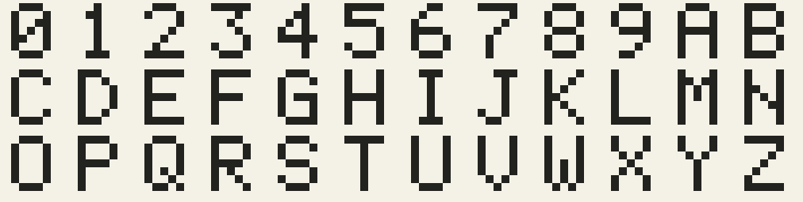
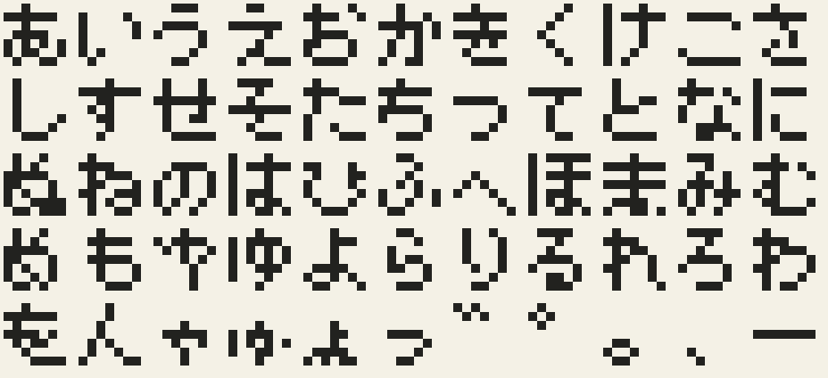
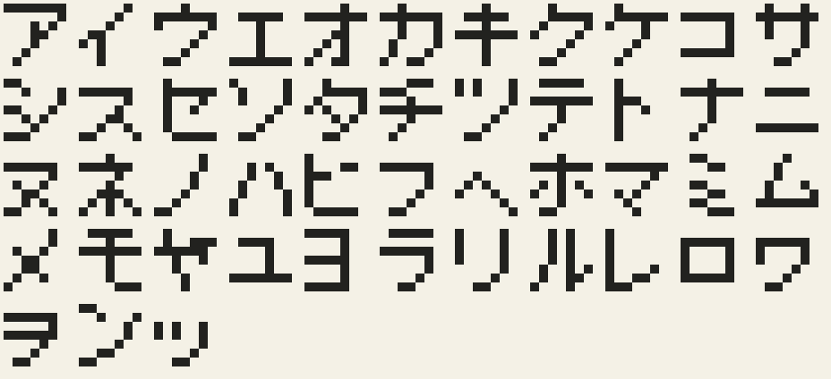
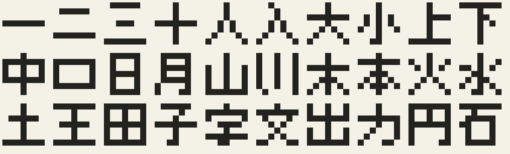
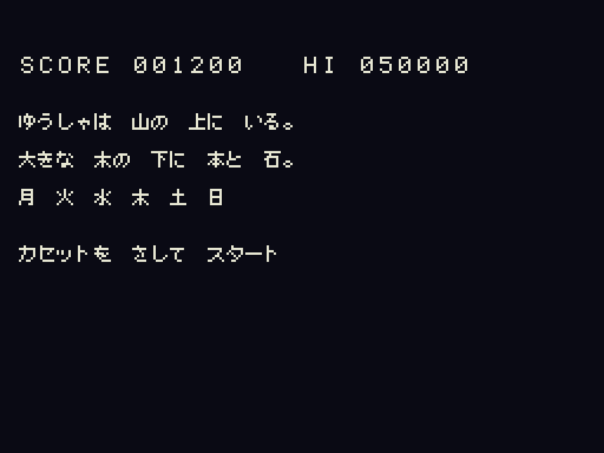
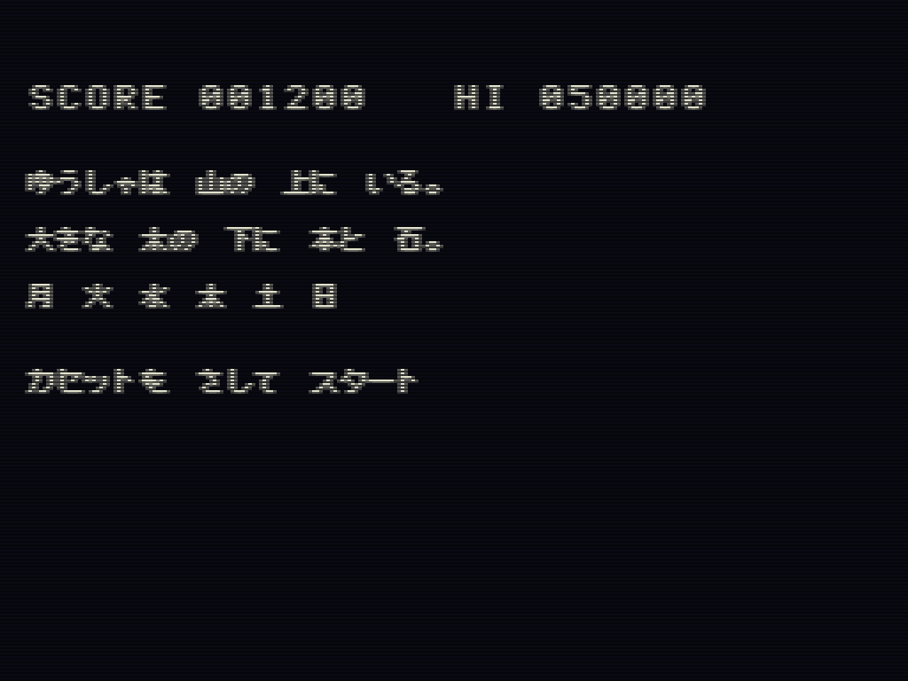
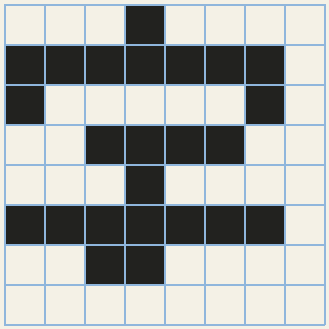

# 書体（文字 ROM の字形）

**v0.1**  
2026年11月25日

> 状態：作業中の版。内部資料「Fictional Machines（仮称）試作機の文字ROM　フォントの試み v0.1」（2026年11月24日、エミュレータ実装編の付属資料）を書き起こし、文書の種類ごとに分けた。元資料は仮の物語と試案で、固まった仕様ではない。関連：[仕様書](../spec/hardware.md) §08（ROM の配置と番地の計算）、[本筋](../story/main.md)（1983年の延期と JIS 改正）、[sources.md](../sources.md) §06（他機種と規格の史実）、字形のデータ [glyphs-v0.1.tsv](glyphs-v0.1.tsv)

記述ステータス：`[確定]`、`[仮]`、`[没]`。物語の中の事実には `[史実]`（出典へリンク）か `[架空]` を付ける。プロジェクトが未確定としている項目（名称、ロゴ、筐体など）は、決定記録を経ずに確定させない。

## 01　原則

- 1983年の試作機は、本体の ROM に漢字の字形を積むことを売りにする。ゲーム機では誰も選ばなかった枝である。 [仮]
- 字は、メーカーの本業である事務機・ワープロの字から導く（03 の系統 A）。字の形は、その会社の手元にある字の技術と、その会社が見ている客から決まる。 [仮]
- 細い線は、テレビで横ににじむと潰れやすい。事務機の字をテレビに持ち込んだことが、この機械の画面の癖になる。 [仮]
- 1985年の最終試作機は、この字形の ROM を引き継ぐ（[仕様書](../spec/hardware.md) §08）。 [仮]

## 02　規則

| 要素 | 規則 | 正典 |
|---|---|---|
| 字の枠 | 8×8 ドット。字の本体は 7×7 で、右と下の1ドットを字間・行間として空ける | [仮] |
| 線 | すべて1ドット | [仮] |
| 英数 | 事務機の印字字形をそのまま持ち込んだ 5×7 | [仮] |
| 漢字の原字 | 1983年に規格があった印字用の 24 ドット字形を縮め、手で直す | [仮] |
| 収録 | 英数カナ（JIS X 0201）256字、非漢字 1〜8区、第一水準（16〜47区）のすべて。256 Kbit の ROM 1個に収める。配置は仕様書 §08 | [仮] |
| 画面の字数 | 256×192 ドットで、1行32字・24行 | [仮] |
| 描き方 | 方眼の上で1マスずつ手で描く | [仮] |

8×8 は、第一水準を ROM 1個に収めるための大きさとして決まる。12×12 では1字18バイトで、第一水準だけで約52 KB になる。16×16 では約93 KB で、どちらも1個に入らない（元資料の計算）。

## 03　作例・検討案

### 字形の現状

描いた字は168字。データは [glyphs-v0.1.tsv](glyphs-v0.1.tsv) にある（区点、JIS X 0201 の符号、Unicode、8行の16進。1行1バイトで MSB が左）。元資料の画像から機械的に読み取ったもので、右の列と下の行に点がないこと、「字」の値が 05 の表と一致することを確かめた。

| 種類 | 字数 |
|---|---:|
| 英数（5×7 の印字字形） | 36 |
| ひらがな・小書き・記号（゛゜。、ー） | 55 |
| カタカナ | 47 |
| 漢字（第一水準2,965字のうち） | 30 |

第一水準の残り2,935字は未作成（[OI-048](../open-issues.md)）。

### テレビ画面での見え方

左が理想の表示。右はテレビのにじみと走査線を加えた表示で、細い線が横ににじんで潰れる。

| 理想の表示 | にじみと走査線を加えた表示 |
|---|---|
|  |  |

### 4つの系統

同じ4字（A・あ・山・字）を、テレビ上の実寸比で並べた。メーカーの出自ごとに「手元にある字の技術」と「その会社が見ている客」から字を導いた。本機のメーカーは業務用電子機器の会社なので、系統 A を本命とする。

| 系統 | 見本 | 導き方 | 字 | 1983年の改正 | 正典 |
|---|---|---|---|---|---|
| A　事務機・ワープロ系 |  | 印字用の 24 ドット字形を縮めて使う。ワープロの字は 24×24 の明朝体だった | すべて 8×8、線は1ドット。第一水準すべて。ROM 約31 KB（256 Kbit 1個）。1行32字 | 直撃（第一水準を JIS の並びどおりに持つ） | [仮]（本命） |
| B　アーケード系 |  | 社内の太いハウス書体を捨てられない。太い線のまま漢字を描くには大きな枠が要り、数を絞る | 英数かなは 8×8 の太字、漢字は 16×16 で教育漢字（約1,000字）。漢字だけで約31 KB。1行はかな32字、漢字16字 | ほぼ無傷（自前の表で字を引く） | [没] |
| C　玩具系 |  | 子どもを狙った玩具メーカーの家庭用コンピュータにならい、子どもが読める大きさを優先する | すべて 16×16 で角を丸める。ひらがな中心、漢字は1年生の分だけ（現行の配当表で80字）。ROM 数 KB。1行16字 | 無傷（独自の文字コード） | [没] |
| D　家電・テレビ系 |  | テレビのにじみを知っている会社なので、横ににじんでも残るように縦線を2ドットにする | 12×12、縦線2ドット・横線1ドット。第一水準すべて。ROM 約63 KB（詰めて並べてやっと 64 KB に収まる）。1行21字 | 直撃（第一水準を JIS の並びどおりに持つ） | [没] |

B・C・D の導き方の根拠にした他社の例は [sources.md](../sources.md) §06 にある。元資料は「規格が変わって発売できなかった筋を残すなら A か D。B か C を選ぶなら、出られなかった理由を別に立てることになる」とする。本筋では JIS 改正は延期の一因で、主因ではない（[本筋](../story/main.md) §03）。

## 04　時代との整合

### 当時の作り方

方眼紙に1マスずつ塗り、1行を2進数から1バイトの16進数に直して、ROM に焼く。当時のゲーム開発でも、大きな方眼紙にドット絵を描いていた [史実]（[sources.md](../sources.md) §06）。漢字の原字は、1983年に規格があった印字用の 24 ドット字形を縮め、手で直した [架空]。1983年の時点では、小さな表示用の手本はない。表示用 16 ドット字形の規格は1984年11月の制定である [史実]（[sources.md](../sources.md) §06）。

| 行 | 2進 | 16進 |
|---|---|---|
| 0 | 00010000 | 10 |
| 1 | 11111110 | FE |
| 2 | 10000010 | 82 |
| 3 | 00111100 | 3C |
| 4 | 00010000 | 10 |
| 5 | 11111110 | FE |
| 6 | 00110000 | 30 |
| 7 | 00000000 | 00 |

「字」は区点 27-90。番地は 0x1F80 ＋ ((27−16)×94 ＋ (90−1))×8 ＝ 0x4298（仕様書 §08 の式）。

### 1983年の改正で崩れる箇所

1983年の改正では、次の区点で第1水準と第2水準の字が入れ替わった。本機の ROM は78年版の並びで焼いてあるので、83年版で書かれた文章をこの機械で出すと、ここで別の字が出る [史実]（[sources.md](../sources.md) §01・§06）。

| 区点 | 本機の ROM（78年版） | 83年版 |
|---|---|---|
| 16-19 | 鰺 | 鯵 |
| 18-09 | 鶯 | 鴬 |
| 19-34 | 蠣 | 蛎 |
| 19-41 | 攪 | 撹 |
| 19-86 | 竈 | 竃 |
| 20-35 | 灌 | 潅 |

どれも画数の多い字で、8×8 ではどちらもほぼ同じ塊になる。崩れたのは字の見た目ではなく、本体とソフトのあいだの番号の約束のほうである。 [仮]

字形・字体が変わった字の数は、元資料が254字、[sources.md](../sources.md) §01 が約300字・294字（後年資料）とし、食い違う。原典で確かめる [V]（[OI-048](../open-issues.md)）。

### 他の字との比較

| 収録 | 8×8 | 12×12 | 16×16 | 24×24 |
|---|---|---|---|---|
| 英数・記号 | アーケードの社内書体 | | | |
| かなまで | ファミコンのソフト、MSX1 の本体 | | | |
| 第一水準 | **本機** | MSX の周辺機器 | パソコン（PC-88 など） | Rupo JW-R10 |
| 第二水準まで | 美咲フォント（後年の個人作） | | | JW-10 |

- **小ささ**：当時、漢字を小さく持った例は、ナショナルの MSX 周辺機器などの 12×12。ゲーム機の周辺では、1988年の PC エンジン CD-ROM² のシステムカードの 12×12。8×8 で漢字を数千字持つ例は、元資料が調べた当時の製品には見当たらない。近いのは後年の美咲フォントで、ほとんどの字を 7×7 で描いている。 [史実]（[sources.md](../sources.md) §06）
- **置き場所**：SG-1000 系は本体に BIOS も BASIC も持たず、ファミコンも字はソフトごとにカセットの中にある。本体に字を持ったのは MSX で、英数・カタカナ・ひらがな、少数の漢字と図形記号だった。1983年の試作機はゲーム機なのに、パソコン側の作りをしている。 [史実]（[sources.md](../sources.md) §06）
- **線の太さ**：アーケードでは太い 8×8 の書体が広く使われ、セガは大きく派手な字をほぼ全作で使った。本機の事務機の細い線は、ゲームの画面では目立たない。 [史実]（[sources.md](../sources.md) §06）
- **原字の出どころ**：JW-10 の字は 24×24 の明朝体で 6,802字。本機はその系譜の印字用字形を縮めた設定で、ワープロの字の子孫にあたる。 [史実]（JW-10）／[架空]（本機の系譜）

## 05　元資料との対応

| 元資料の節 | 移した先 |
|---|---|
| 01 要点、02 物語の前提 | 本書 01。経緯は [本筋](../story/main.md) の 1983-09 と §03「JIS 改正の扱い」。元資料は「焼き直しのあいだに年末商戦を逃し、発売中止」とするが、本筋では延期とし、1983末〜84年の再設計を経て1985年の最終試作機に続く。延期が致命傷になる前例（カシオ PV-1000）は [sources.md](../sources.md) §06 |
| 03 固定条件と試算 | 本書 02、仕様書 §08（ROM の内訳と番地の式は同じ） |
| 04 本機の字 | 本書 03、[glyphs-v0.1.tsv](glyphs-v0.1.tsv) |
| 05 当時の作り方、06 83年改正で崩れる箇所 | 本書 04 |
| 07 他の字との比較 | 本書 04、[sources.md](../sources.md) §06 |
| 08 4つの系統 | 本書 03 |
| 09 未確認・次の作業 | [OI-048](../open-issues.md) |
| 10 出典 | [sources.md](../sources.md) §06 と資料一覧 |

書き起こすときの変更：実在の人物の名前を役割に置き換えた。ゲーム1本の容量（スーパーマリオブラザーズ 40 KB、ドラゴンクエスト 64 KB）と、規格の一部だけの実装は互換とみなされないことは、[sources.md](../sources.md) §06 に移した。
