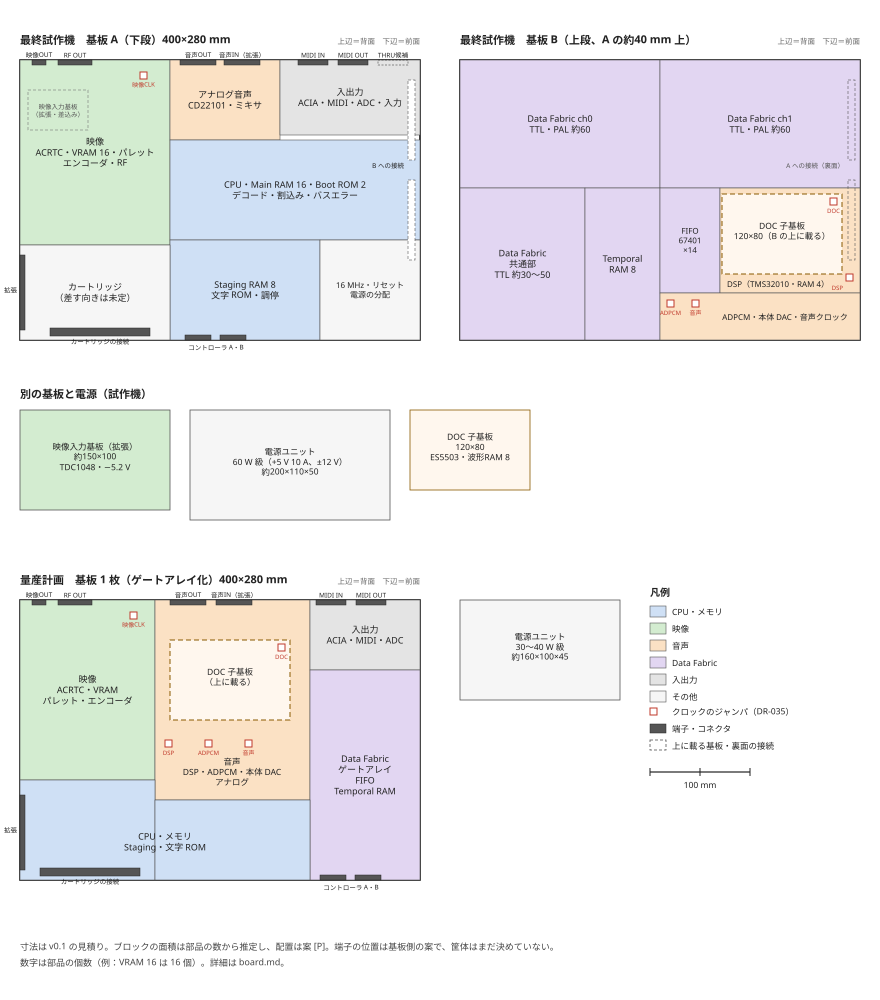

# 基板と外形の見積り

**v0.1**  
2026年11月25日

> 状態：作業中の版。正確な設計ではなく、筐体の外形を考えるための大まかな見積り。部品の数は [仕様書](hardware.md) から数え、面積は実装密度を仮定して推定した。値はすべて [P] か [V]。関連：[DR-036](../decisions.md)、[OI-049](../open-issues.md)

## 01　前提

- 見積りの対象は2つ。
  - **最終試作機（1985年）**：Data Fabric を PAL と TTL で組む（DR-010）。エミュレータが再現するのはこの機械。
  - **量産計画**：Data Fabric をゲートアレイにする（DR-010）。量産はされなかった（DR-014）。
- 両面のスルーホール基板に、DIP などの挿入部品を載せる [P]。4層にすれば小さくなるが、当時の家庭用の機器では両面が普通（推定 [V]）。
- 配線の通り道を含めた1個あたりの面積を次のように仮定する [P]。合計に、端子・取付け穴・電源の配線・基板の縁の分として 1.3〜1.35 倍を掛ける。

| 部品 | 1個あたりの面積 |
|---|---:|
| 14〜20ピンの DIP（幅 0.3 インチ）：TTL、PAL、67401、HM6168H、74LS189、HA17408、MSM5205 | 3.5 cm² |
| DRAM の並び（4164、HM4864A） | 2.5 cm² |
| 24〜28ピンの DIP（幅 0.6 インチ）：27256、HM6264、HD6850、CD22101、A/D | 8 cm² |
| 40ピンの DIP：TMS32010、ES5503 | 12 cm² |
| 64ピンの DIP：HD68000、HD63484 | 25 cm² |

## 02　部品の数と面積

数は本体の基板だけ。DOC 子基板と映像入力基板（拡張）は 03 に書く。

| ブロック | 最終試作機の主な部品 | 試作機 | 量産計画での変化 | 量産計画 |
|---|---|---:|---|---:|
| CPU・メモリ | HD68000、Boot ROM 27256×2、Main RAM 4164×16、デコード・DRAM の制御・割込み・バスエラー（TTL 約30） | 約250 cm² | TTL 約15 | 約190 cm² |
| Staging RAM・文字 ROM | HM6264×8、27256×1、調停（TTL 約13） | 約160 cm² | TTL 約4 | 約110 cm² |
| 映像 | HD63484、HM4864A×16、VRAM の制御（TTL 約12）、表示のラッチ（約8）、パレット 74LS189×6 と制御（約4）、抵抗 DAC・同期・BA7230LS、RF モジュレータ | 約280 cm² | TTL 約10 | 約240 cm² |
| DSP | TMS32010、HM6168H×4、分離回路・BIO・ブリッジ（TTL 約21） | 約140 cm² | TTL 約10 | 約80 cm² |
| ADPCM・本体 DAC・音声クロック | MSM5205、HA17408×2、ブリッジ・分周器・DAC の制御（TTL 約13）、I/V 変換・LPF | 約100 cm² | TTL 約8 | 約75 cm² |
| アナログ音声 | CD22101×2、オペアンプ約8、ミキサ・出力 | 約85 cm² | 同じ | 約80 cm² |
| 入出力 | HD6850、MIDI のフォトカプラ、8チャネルの A/D（AXIS0〜7。型番は未定 [V]）、入力と拡張のバッファ（TTL 約15） | 約100 cm² | TTL 約10 | 約75 cm² |
| Data Fabric | TTL・PAL 約140〜180（[review-digital.md](../parts/review-digital.md)）、67401×14 | 約820 cm² | ゲートアレイ 1、TTL 約20、67401×14 | 約170 cm² |
| Temporal RAM | HM6264×8、カウンタ（TTL 約6） | 約115 cm² | TTL 約2 | 約90 cm² |
| クロック・リセット・電源の分配 | 発振器、分周 | 約20 cm² | | 約15 cm² |
| **合計** | **IC 約380個** | **約2,060 cm²** | **IC 約180個** | **約1,120 cm²** |

- 量産計画では、Data Fabric 以外のつなぎ回路の一部も2個目のゲートアレイにまとめると仮定した（約半分に減る）[O]。
- メモリを 64K×4 の DRAM と 32K×8 の SRAM にすれば、量産計画の IC はさらに約35個、面積は約150 cm² 減る。1985年に量産品として手に入ったかは [V]（[OI-049](../open-issues.md)）。
- 試作機を1枚にすると約 50×42 cm になり、家庭用の筐体に収まらない。

## 03　基板の分け方

### 最終試作機

| 基板 | 大きさ | 載せるもの |
|---|---|---|
| A（下段） | 400×280 mm | CPU・メモリ、Staging RAM、文字 ROM、映像、アナログ音声、入出力、すべての端子 |
| B（上段） | 400×280 mm。A の約 40 mm 上 | Data Fabric、Temporal RAM、DSP、ADPCM、本体 DAC、音声クロック |
| DOC 子基板 | 120×80 mm | ES5503、波形 RAM HM4864A×8、出力のアンプ、−5 V のレギュレータ。B の上面に差す（DR-011） |
| 映像入力基板（拡張） | 約 150×100 mm | TDC1048、同期分離、−5.2 V のレギュレータと放熱板。A の背面寄りに差し、A と B の間に収める [V] |
| 電源ユニット | 60 W 級、約 200×110×50 mm | 筐体の中に置くか、別の箱にするかは未定 |

- A と B は 100 ピン級のコネクタ2組でつなぐ。ホストバス（約50本）、Fabric のポートの信号（Staging、文字 ROM、ACRTC の DMA）、本体 DAC の出力、電源が渡る [V]。
- 分け方の考え方：FIFO で Data Fabric とつながる IC（DSP、ADPCM、本体 DAC）は Fabric と同じ B に載せる。端子が要る回路は A の縁に置く。こうすると、基板の間を渡る信号が少なく、上段の B から背面へ配線を引き回さずに済む。

### 量産計画

| 基板 | 大きさ | 載せるもの |
|---|---|---|
| 主基板 | 400×280 mm（試作機の A と同じ外形） | すべて |
| DOC 子基板 | 120×80 mm | 試作機と同じ。音声部の上に差す |
| 電源ユニット | 30〜40 W 級、約 160×100×45 mm | 筐体の中 |

量産計画の基板を試作機の A と同じ外形にすると、取付け穴と端子の位置がそろい、筐体の設計を試作機と量産で共有できる。試作機は B の分だけ高くなる [P]（DR-036）。

## 04　端子

位置は基板の側の案 [P]。筐体の設計で動かしてよい。

| 端子 | 個数・形 | 位置 | 備考 |
|---|---|---|---|
| 映像 OUT | RCA×1 | 背面 | NTSC コンポジット（仕様書 §10） |
| RF OUT | RF モジュレータ（VHF 1/2ch、金属ケース）と切替スイッチ | 背面 | 家庭のテレビのアンテナ端子へ [P]（DR-036） |
| 音声 OUT | RCA×2（L/R） | 背面 | |
| 音声 IN | RCA×2 | 背面 | ミキサへの入力は本体。A/D は音声入力基板（拡張、port 10） |
| 映像 IN | RCA×1 | 背面 | 映像入力基板（拡張）に付く。付けないときは穴をふさぐ |
| MIDI IN／OUT | 5ピン DIN×2 | 背面 | THRU は候補で、穴の位置だけ残す [O] |
| コントローラ A・B | 2個。形は保留（仕様書 §09） | 前面 | |
| カートリッジ | 2.54 mm ピッチのカードエッジ、約60極（幅約80 mm）[V] | 前面寄り | 上から差すか前から差すかは未定。試作機では B が上を覆うので、上から差すには B を避ける形にする必要がある |
| 拡張 | カードエッジ、約60〜64極 | 左の側面 | ホストバス、IRQ、EXTRIG（仕様書 §09） |
| 電源スイッチ・リセット・表示灯 | | 未定 | 筐体で決める |

## 05　高さ

| 項目 | 最終試作機 | 量産計画 |
|---|---:|---:|
| 基板の下の空き | 約 10 mm | 約 10 mm |
| 下段の部品の高さ（DIN、電解コンデンサ） | 最大約 20 mm | 最大約 20 mm |
| B の位置 | A の約 40 mm 上 | — |
| DOC 子基板 | B の上に、部品込みで約 25 mm | 基板の上に、部品込みで約 25 mm |
| 中の高さの合計 | 約 90 mm | 約 50 mm |
| 筐体の外寸の高さ（目安） | 約 100〜110 mm | 約 60〜70 mm |

カートリッジを上から差す場合は、差したカートリッジがさらに上に出る。

## 06　電源と熱

- **最終試作機**：+5 V は 5〜10 A 級（仕様書 §10。67401×14 だけで 2.2〜2.8 A [V]）。±12 V を足して、電源は 60 W 級。筐体の中の発熱は 40〜55 W 程度で、通風口が要り、ファンが要るかもしれない [V]。
- **量産計画**：Data Fabric を CMOS のゲートアレイにし、TTL が約 200 個減るので、+5 V は 4〜6 A 程度 [V]。電源は 30〜40 W 級で、通風口による自然の空冷を想定する [V]。
- 電源ユニットの置き場所（基板の横、基板の後ろ、別の箱）で、筐体の幅と奥行きが変わる。基板の横なら約 540×310 mm、後ろなら約 430×420 mm、別の箱なら約 430×310 mm（壁の厚さ込みの目安）。家庭用ゲーム機より、据置きのパソコン本体やビデオデッキに近い大きさになる（推定）。

## 07　ベンド点の置き場所

- 最終試作機では、DOC・MSM5205・音声クロック・DSP のクロックのジャンパ（DR-035）を B の上面に集め、DOC 子基板もそこに差す。上の蓋を開けると、音のベンド点がまとめて見える。
- 映像系のクロックのジャンパは、A の背面寄りの映像部に置く。映像入力基板・ゲンロック基板（DR-013）の差込みの近く。
- テストピン（DR-034）は各 IC の近くに置き、Boot ROM と文字 ROM のソケットは A に置く。
- 量産計画では、ジャンパは部品を載せないパッドとして残り、テストピンは工場の検査用のパッドになる。ROM はマスク ROM をはんだ付けする。量産品でも、はんだ付けをすればピッチの改造ができる [P]（DR-036）。
- ベンド点に手が届く蓋を筐体に設けるかは、筐体の設計で決める。

## 08　筐体の設計へ渡す条件

1. 基板の外形は 400×280 mm（試作機の A、量産計画の主基板）。取付け穴の位置は未定 [V]。
2. 中の高さは、試作機で約 90 mm、量産計画で約 50 mm。
3. 端子は背面に映像・RF・音声・MIDI、前面にコントローラ、左の側面に拡張（04）。
4. 電源ユニットの大きさと発熱（06）。通風口の位置。
5. 筐体で決めること：
   - 外形と、試作機と量産で外形を共有するか
   - カートリッジを差す向き
   - 電源ユニットの置き場所
   - 電源スイッチの位置
   - ベンド点や DOC 子基板に届く蓋を設けるか

筐体そのものは [design/](../design/main.md) で扱い、決定記録を経るまで確定させない。
