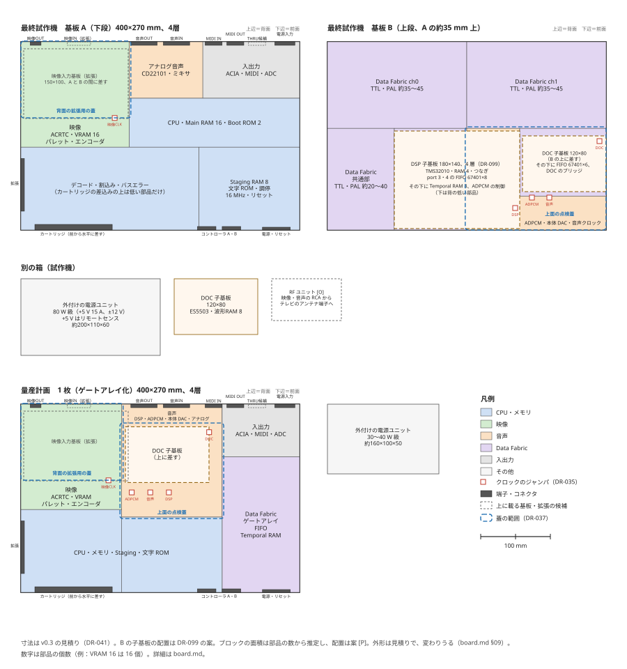

# 基板と外形の見積り

**v0.2**  
2026年11月25日

> 状態：作業中の版。正確な設計ではなく、筐体の外形を考えるための大まかな見積り。部品の数は [仕様書](hardware.md) から数え、面積は実装密度を仮定して推定した。値はすべて [P] か [V]。関連：[DR-036](../decisions.md)、[DR-037](../decisions.md)、[OI-049](../open-issues.md)

## 01　前提

- 見積りの対象は2つ。
  - **最終試作機（1985年）**：Data Fabric を PAL と TTL で組む（DR-010）。エミュレータが再現するのはこの機械。
  - **量産計画**：Data Fabric をゲートアレイにする（DR-010）。量産はされなかった（DR-014）。
- 4層のスルーホール基板に、DIP などの挿入部品を載せる [P][V]（DR-037）。内側の2層を電源と GND にあて、外側の2層を信号の配線に使う。
- 配線の通り道を含めた1個あたりの面積を次のように仮定する [P]。合計に、端子・取付け穴・基板の縁の分として 1.3〜1.35 倍を掛ける。4層の基板では、電源の配線が内側の層に移るので、さらに 0.8 倍とする（推定 [V]）。

| 部品 | 1個あたりの面積（両面基板） |
|---|---:|
| 14〜20ピンの DIP（幅 0.3 インチ）：TTL、PAL、67401、HM6168H、74LS189、HA17408、MSM5205 | 3.5 cm² |
| DRAM の並び（4164、HM4864A） | 2.5 cm² |
| 24〜28ピンの DIP（幅 0.6 インチ）：27256、HM6264、HD6850、CD22101、A/D | 8 cm² |
| 40ピンの DIP：TMS32010、ES5503 | 12 cm² |
| 64ピンの DIP：HD68000、HD63484 | 25 cm² |

## 02　部品の数と面積

数は本体の基板だけ。DOC 子基板と映像入力基板（拡張）は 03 に書く。面積は両面基板で計算した値で、4層の値は表の下に書く。

| ブロック | 最終試作機の主な部品 | 試作機 | 量産計画での変化 | 量産計画 |
|---|---|---:|---|---:|
| CPU・メモリ | HD68000、Boot ROM 27256×2、Main RAM 4164×16、デコード・DRAM の制御・割込み・バスエラー（TTL 約30） | 約250 cm² | TTL 約15 | 約190 cm² |
| Staging RAM・文字 ROM | HM6264×8、27256×1、調停（TTL 約13） | 約160 cm² | TTL 約4 | 約110 cm² |
| 映像 | HD63484、HM4864A×16、VRAM の制御（TTL 約12）、表示のラッチ（約8）、パレット 74LS189×6 と制御（約4）、抵抗 DAC・同期・BA7230LS | 約280 cm² | TTL 約10 | 約240 cm² |
| DSP | TMS32010、HM6168H×4、分離回路・BIO・ブリッジ（TTL 約21） | 約140 cm² | TTL 約10 | 約80 cm² |
| ADPCM・本体 DAC・音声クロック | MSM5205、HA17408×2、ブリッジ・分周器・DAC の制御（TTL 約13）、I/V 変換・LPF | 約100 cm² | TTL 約8 | 約75 cm² |
| アナログ音声 | CD22101×2、オペアンプ約8、ミキサ・出力 | 約85 cm² | 同じ | 約80 cm² |
| 入出力 | HD6850、MIDI のフォトカプラ、8チャネルの A/D（AXIS0〜7。型番は未定 [V]）、入力と拡張のバッファ（TTL 約15） | 約100 cm² | TTL 約10 | 約75 cm² |
| Data Fabric | TTL・PAL 約140〜180（[review-digital.md](../parts/review-digital.md)）、67401×14 | 約820 cm² | ゲートアレイ 1、TTL 約20、67401×14 | 約170 cm² |
| Temporal RAM | HM6264×8、カウンタ（TTL 約6） | 約115 cm² | TTL 約2 | 約90 cm² |
| クロック・リセット・電源の分配 | 発振器、分周 | 約20 cm² | | 約15 cm² |
| **合計（両面基板）** | **IC 約380個** | **約2,060 cm²** | **IC 約180個** | **約1,120 cm²** |
| **合計（4層基板）** | | **約1,650 cm²** | | **約900 cm²** |

- 4層の試作機の内訳は、A が約 710 cm²（ほかにカートリッジの差込みの場所 約 70 cm²）、B が約 870〜940 cm²。B は 360×250 mm（900 cm²）に対して窮屈で、Data Fabric の TTL が見積りの下の方（約140個）に収まるか、PAL を少し増やす必要がある [V]。PAL は TTL より消費電流が大きい。
- 量産計画では、Data Fabric 以外のつなぎ回路の一部も2個目のゲートアレイにまとめると仮定した（約半分に減る）[O]。
- メモリを 64K×4 の DRAM と 32K×8 の SRAM にすれば、量産計画の IC はさらに約35個減り、面積も小さくなる。1985年に量産品として手に入ったかは [V]（[OI-049](../open-issues.md)）。

## 03　基板の分け方

### 最終試作機

| 基板 | 大きさ | 載せるもの |
|---|---|---|
| A（下段） | 360×250 mm、4層 | CPU・メモリ、Staging RAM、文字 ROM、映像、アナログ音声、入出力、すべての端子、カートリッジの差込み |
| B（上段） | 360×250 mm、4層。A の約 35 mm 上 | Data Fabric、Temporal RAM、DSP、ADPCM、本体 DAC、音声クロック |
| DOC 子基板 | 120×80 mm | ES5503、波形 RAM HM4864A×8、出力のアンプ、−5 V のレギュレータ。B の上面に差す（DR-011） |
| 映像入力基板（拡張） | 約 150×100 mm | TDC1048、同期分離、−5.2 V のレギュレータと放熱板。A の映像部の上、A と B の間に差す [V] |

- A と B は 100 ピン級のコネクタ2組でつなぐ。ホストバス（約50本）、Fabric のポートの信号（Staging、文字 ROM、ACRTC の DMA）、本体 DAC の出力、電源が渡る [V]。
- 分け方の考え方：FIFO で Data Fabric とつながる IC（DSP、ADPCM、本体 DAC）は Fabric と同じ B に載せる。端子が要る回路は A の縁に置く。こうすると、基板の間を渡る信号が少なく、上段の B から背面へ配線を引き回さずに済む。

### 量産計画

| 基板 | 大きさ | 載せるもの |
|---|---|---|
| 主基板 | 360×250 mm、4層（試作機の A と同じ外形） | すべて |
| DOC 子基板 | 120×80 mm | 試作機と同じ。音声部の上に差す |

量産計画の基板を試作機の A と同じ外形にすると、取付け穴と端子の位置がそろい、筐体の設計を試作機と量産で共有できる。試作機は B の分だけ高くなる [P]（DR-036、DR-037）。

### 電源ユニット（外付け）

- 電源ユニットは本体の外の箱に入れる [P]（DR-037）。試作機は 60 W 級（約 200×110×60 mm）、量産計画は 30〜40 W 級（約 160×100×50 mm）。
- 本体とは多ピンの丸形コネクタのケーブルでつなぐ。+5 V と GND はそれぞれ複数のピンに分け、+5 V はリモートセンスの線で、ケーブルの電圧降下（10 A 級で数百 mV）を電源ユニットの側で補う [P][V]。リモートセンスは業務用のスイッチング電源では普通の機能（推定）。
- 本体の中の発熱が減り、筐体を小さくできる。
- 現代の再現では、USB PD などの現代の電源から +5／±12 V を作る [O]（仕様書 §13）。

## 04　端子

| 端子 | 個数・形 | 位置 | 備考 |
|---|---|---|---|
| 映像 OUT | RCA×1 | 背面 | NTSC コンポジット（仕様書 §10） |
| 音声 OUT | RCA×2（L/R） | 背面 | |
| 音声 IN | RCA×2 | 背面 | ミキサへの入力は本体。A/D は音声入力基板（拡張、port 10） |
| 映像 IN | RCA×1 | 背面 | 映像入力基板（拡張）に付く。付けないときは穴をふさぐ |
| MIDI IN／OUT | 5ピン DIN×2 | 背面 | THRU は候補で、穴の位置だけ残す [O] |
| 電源入力 | 多ピンの丸形コネクタ | 背面の右 | 外付けの電源ユニットから |
| コントローラ A・B | 2個。形は保留（仕様書 §09） | 前面の右寄り | |
| カートリッジ | 2.54 mm ピッチのカードエッジ、約60極（幅約 80 mm）[V] | 前面の左寄り | 前から水平に差す。差したカートリッジは A と B の間に入る |
| 拡張 | カードエッジ、約60〜64極 | 左の側面 | ホストバス、IRQ、EXTRIG（仕様書 §09） |
| 電源スイッチ・リセット・表示灯 | | 前面の右端 | |

- **RF**：本体には RF モジュレータを載せない。テレビのアンテナ端子につなぐ場合は、映像・音声の RCA から変換する別の箱（RF ユニット）を使う [O]（DR-037）。1985年には、ビデオデッキやパソコンにコンポジット映像の出力（RCA ピン）があり、ビデオ入力の付いたテレビやモニタも売られていた。家庭のテレビのうちビデオ入力を持つものの割合は確かめていない [V]（[OI-049](../open-issues.md)）。

## 05　高さと外形

| 項目 | 最終試作機 | 量産計画 |
|---|---:|---:|
| 基板の下の空き | 約 10 mm | 約 10 mm |
| 下段の部品の高さ（DIN、電解コンデンサ） | 最大約 20 mm | 最大約 20 mm |
| B の位置 | A の約 35 mm 上 | — |
| DOC 子基板 | B の上に、部品込みで約 25 mm | 基板の上に、部品込みで約 25 mm |
| 中の高さの合計 | 約 80 mm | 約 50 mm |
| 筐体の外寸の高さ（目安） | 約 90〜100 mm | 約 55〜65 mm |
| 筐体の外寸の幅×奥行き（目安） | 約 390×280 mm | 約 390×280 mm |

- 幅と奥行きは、基板に壁の厚さと隙間（片側 15 mm 程度）を足した値。背面の端子の出っ張りは含まない。
- カートリッジは前から水平に差すので、上に出ない。カートリッジの差込み口の高さは A の上 10〜30 mm 程度 [V]。カートリッジが入る範囲の A には、背の低い部品だけを置く。

## 06　電源と熱

- **最終試作機**：+5 V は 5〜10 A 級（仕様書 §10。67401×14 だけで 2.2〜2.8 A [V]）。±12 V を足して、電源は 60 W 級。電源を外付けにしても、本体の中で 30〜50 W 程度の熱が出るので、通風口が要る。ファンが要るかは [V]。
- **量産計画**：Data Fabric を CMOS のゲートアレイにし、TTL が約 200 個減るので、+5 V は 4〜6 A 程度 [V]。電源は 30〜40 W 級。通風口による自然の空冷を想定する [V]。

## 07　ベンド点と蓋

蓋は2つ設ける [P]（DR-037）。

| 蓋 | 位置 | 届くもの |
|---|---|---|
| 上面の点検蓋 | 上面の右前寄り（B の音声部の上） | DOC 子基板、DOC・MSM5205・音声クロック・DSP のクロックのジャンパ（DR-035）、その付近のテストピン |
| 背面の拡張用の蓋 | 背面の左（A の映像部） | 映像入力基板・ゲンロック基板（DR-013）の差込み、映像系のクロックのジャンパ |

- 音のクロックのジャンパは B の上面に1か所に集め、DOC 子基板もそこに差す。上面の蓋を開けると、音のベンド点がまとめて見える。DOC 子基板は外しても動く（DR-019）ので、この蓋は音源基板の増設口も兼ねる。
- テストピン（DR-034）は各 IC の近くに置き、Boot ROM と文字 ROM のソケットは A に置く。蓋から届かないものは、筐体を開けて触る。
- 量産計画では、ジャンパは部品を載せないパッドとして残り、テストピンは工場の検査用のパッドになる。ROM はマスク ROM をはんだ付けする。量産品でも、はんだ付けをすればピッチの改造ができる [P]（DR-036）。

## 08　筐体の設計へ渡す条件

1. 基板の外形は 360×250 mm（試作機の A と B、量産計画の主基板）。取付け穴の位置は未定 [V]。
2. 外寸の目安は約 390×280 mm。高さは試作機で約 90〜100 mm、量産計画で約 55〜65 mm（05）。
3. 端子は背面に映像・音声・MIDI・電源入力、前面にカートリッジ・コントローラ・電源スイッチ、左の側面に拡張（04）。
4. 上面の点検蓋と背面の拡張用の蓋（07）。
5. 本体の中の発熱（06）と通風口の位置。
6. 電源ユニットと RF ユニットは別の箱。
7. 筐体で決めること：外形と意匠、試作機と量産で外形を共有するか、蓋の形と開け方。

筐体の外観の大枠は [design/enclosure.md](../design/enclosure.md) に置く（[仮]、DR-038）。
